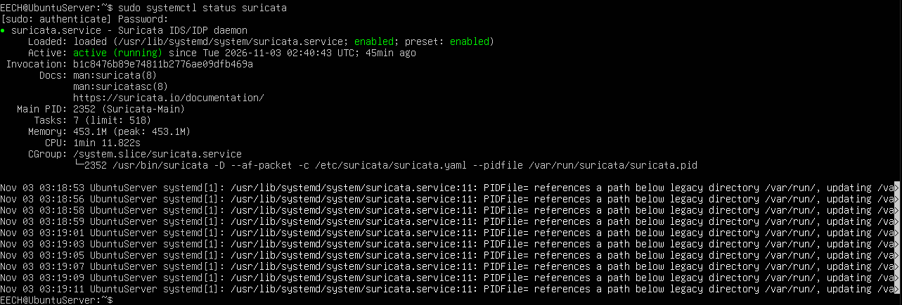
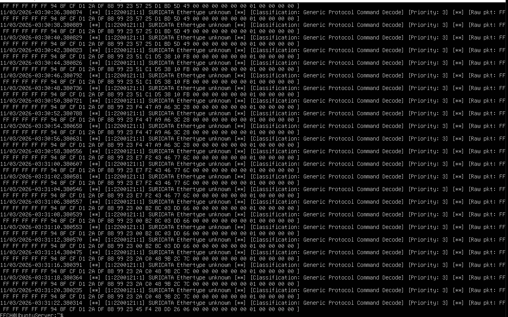
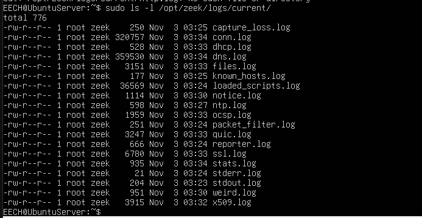

# Lab: Network Intrusion Detection & Analysis (Suricata & Zeek)

This repository contains the documentation, configuration snippets, and operational evidence for **Laboratory 10**, focusing on the deployment, configuration, and verification of Network Intrusion Detection Systems (NIDS) using **Suricata** and **Zeek** on an Ubuntu Server environment.

## Table of Contents
1. [Environment Overview](#environment-overview)
2. [Suricata NIDS Configuration & Verification](#suricata-nids-configuration--verification)
3. [Zeek NIDS Setup & Log Analysis](#zeek-nids-setup--log-analysis)
4. [Lab Evidence & Screenshots](#lab-evidence--screenshots)

---

## Environment Overview
* **Operating System:** Ubuntu Server
* **Monitored Interface:** `enp0s3`
* **Security Frameworks:** 
  * **Suricata v8.0.3** (Signature-based packet inspection and alerting)
  * **Zeek** (Network analysis framework and metadata logging)

---

## Suricata NIDS Configuration & Verification

Suricata was configured in IDS mode to inspect live traffic on the primary network interface (`enp0s3`).

### Configuration Highlight (`suricata.yaml`)
```yaml
af-packet:
  - interface: enp0s3
    cluster-id: 99
    cluster-type: cluster_flow
    defrag: yes
```

### Service Verification & Logs
* **Service Status:** Verified that Suricata runs smoothly under systemd:
  ```bash
  sudo systemctl status suricata
  ```
* **Alert Inspection:** Live signatures and alerts are recorded in real-time within the fast log:
  ```bash
  sudo tail -f /var/log/suricata/fast.log
  ```

---

## Zeek NIDS Setup & Log Analysis

Zeek was deployed using the official OpenSUSE Build Service repository, placing binaries under `/opt/zeek/bin/`.

### Node Configuration (`node.cfg`)
Configured in standalone mode targeting `enp0s3` inside `/opt/zeek/etc/node.cfg`:
```text
[zeek]
type=standalone
host=localhost
interface=enp0s3
```

### Deployment & Control
* **Compilation & Deployment:**
  ```bash
  sudo /opt/zeek/bin/zeekctl deploy
  ```
* **Status Check:**
  ```bash
  sudo /opt/zeek/bin/zeekctl status
  ```

### Log Generation
Zeek automatically builds connection and protocol metadata within the working directory:
```bash
sudo ls -l /opt/zeek/logs/current/
```

---

## Lab Evidence & Screenshots

| Evidence File | Description |
| :--- | :--- |
|  | Systemd service status showing Suricata as `active (running)`. |
|  | Real-time security alerts captured inside `/var/log/suricata/fast.log`. |
|  | Active network metadata log files generated by Zeek (`conn.log`, `dns.log`, `ssl.log`, etc.). |
